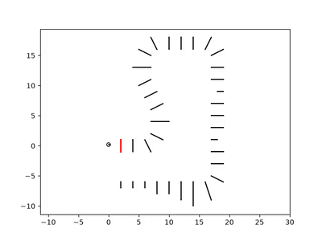
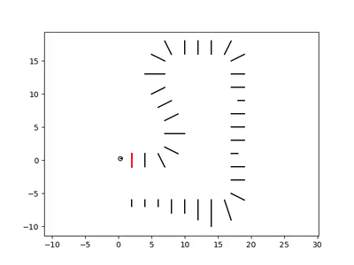
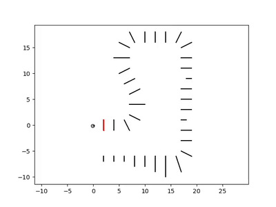

# Reinforcement Learning for Autonomous Race Track Navigation


A **Soft Actor-Critic (SAC)** agent that learns time-optimal driving through a 34-gate race course. The vehicle has acceleration limits, speed-dependent steering and noisy actuation. The trained model included in this repo finishes the course in **50 / 50** evaluation runs, taking a median of **85 steps**.

<p align="center">
  
  <br>
  <em>The included model (<code>models/sac_parcour_best.zip</code>) driving the full parcour. The red line marks the next gate.</em>
</p>

---

## Results

Evaluation of [`models/sac_parcour_best.zip`](models) over **50 episodes**, using the deterministic policy with the environment's actuation noise switched **on**:

| Metric | Result |
|---|---|
| Success rate (all 34 gates passed) | **50 / 50 (100%)** |
| Steps to finish | **median 85** (min 83, max 86), ≈ 17 s of simulated time at Δt = 0.2 s |
| Training budget | 150,000 environment steps |

Reproduce it with `python Inference/evaluate.py --model models/sac_parcour_best.zip --episodes 50`.

### Learning progression

The same course, rolled out with the deterministic policy at different points in training:

| Episode 10 | Episode 40 |
|:---:|:---:|
|  |  |
| Loses the course after a few gates | Reaches about halfway (gate 17 / 34) before the time limit |
| **Episode 100** | **Episode 400** |
|  |  |
| Gets to the second-to-last gate before the time limit | Completes all 34 gates |

Full-resolution MP4s are in [`media/`](media).

---

## Problem setup

The environment ([`race_acc.py`](race_acc.py)) is a 2D vehicle that must pass a sequence of gates (line segments) in order.

| | |
|---|---|
| **State** | `x, y, θ, v_trans, v_rot` |
| **Action** | translational and rotational acceleration, limited to ±0.5 m/s² and ±0.2 rad/s² |
| **Dynamics** | Δt = 0.2 s, max 5 m/s, no reversing; available steering shrinks as speed increases |
| **Noise** | Gaussian noise added to both acceleration commands at every step |
| **Episode** | ends when the last gate is passed, or after 300 steps |
| **Course** | `Parcour`: 34 gates forming a winding loop (`StraightRace` and `CurvyRace` are also included) |

## Approach

The original environment is left unchanged. [`agent.py`](agent.py) wraps it in a Gymnasium-compatible adapter that adds:

**Richer observations (13-D)**: the 5 base state values plus the centres of the next **4 gates** expressed in the vehicle's own frame. This lets the policy plan ahead instead of reacting gate by gate.

**Reward shaping**

| Term | Purpose |
|---|---|
| + bonus per gate passed, large bonus for the final gate | sparse task reward |
| + 2 × (decrease in distance to the next gate centre) | dense progress signal |
| − small constant per step | encourages the fastest lap |
| − penalty near the world boundary | discourages drifting away |

**Action scaling**: SAC outputs actions in [-1, 1], which are mapped to the physical acceleration limits.

**SAC hyperparameters** (tuned in a hyperparameter sweep)

| Parameter | Value |
|---|---|
| Network | MLP, 2 × 256 |
| Learning rate | 2.77 × 10⁻⁴ |
| γ / τ | 0.932 / 0.028 |
| Batch size / buffer | 64 / 1M |
| Gradient steps per env step | 4 |
| Entropy coefficient | auto (init 0.1) |
| Warm-up steps | 4,822 |

To measure **sample efficiency** and consistency, training runs as 10 independent instances. Each logs the environment steps needed to solve the course for the first time, and its best (shortest) solving episode.

---

## Repository structure

```text
racing_car/
├── agent.py                 # Gymnasium adapter, reward shaping, SAC training (10 runs)
├── race_acc.py              # Race environment: dynamics, gates, plotting
├── Inference/
│   ├── run_inference.py     # Load a trained model, run episodes, export MP4s
│   └── evaluate.py          # Success rate and steps over N episodes
├── models/
│   └── sac_parcour_best.zip # Trained SAC policy (best of the training runs)
├── media/                   # Rollout GIFs and MP4s
└── requirements.txt
```

## Getting started

```bash
git clone https://github.com/arpitha-co/racing_car.git
cd racing_car
pip install -r requirements.txt
# ffmpeg is needed to save videos:  brew install ffmpeg  |  sudo apt-get install ffmpeg
```

### Try the trained model

```bash
# watch / record it
python Inference/run_inference.py --model models/sac_parcour_best.zip \
  --deterministic --episodes 3 --save-video --out-dir videos

# measure it
python Inference/evaluate.py --model models/sac_parcour_best.zip --episodes 50
```

### Train from scratch

```bash
python agent.py                 # set SB3_DEVICE=cpu|cuda to force a device
```

For each of the 10 runs, this writes:

- `animations_restful_<run>/parcour_ep_*.mp4`: a rollout every 10 episodes
- `episode_steps_<run>.csv`: steps per episode
- `tensorboard_logs/`: reward and episode-length curves (`tensorboard --logdir tensorboard_logs`)
- `sac_parcour_<run>_<timestamp>.zip`: the trained model

A summary across all runs is written to `training_results.txt`.

Any of these `.zip` files can be passed to the inference and evaluation scripts in place of the included model.

To drive the course yourself with the arrow keys, run `python race_acc.py`.

---

## Author

**Arpitha Thimmegowda** · M.Sc. AI for Industrial Applications, OTH Amberg-Weiden
[GitHub](https://github.com/arpitha-co) · [LinkedIn](https://www.linkedin.com/in/arpitha-t-aa375421b/)

*The base race environment (`race_acc.py`) was provided as part of a university reinforcement-learning course.*
